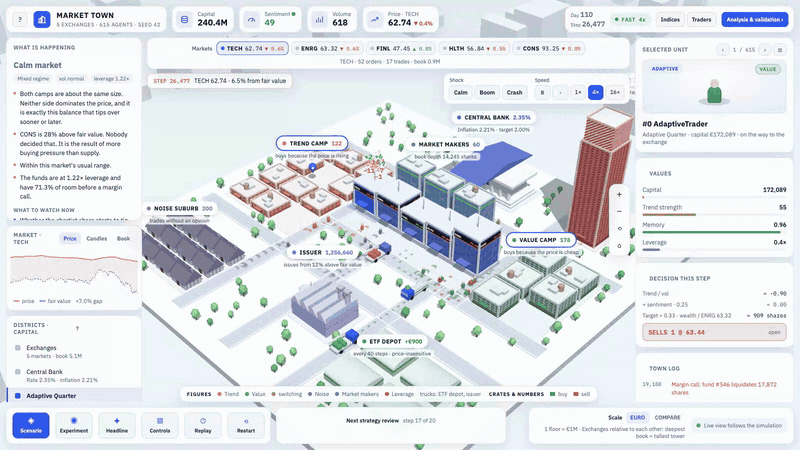

# Market Ecology Simulator

An agent-based equity market: 615 agents trade five sector stocks, and there is no
formula for the price anywhere in the code. Every price comes out of orders meeting
in a continuous double auction, so booms, crashes and forced-selling cascades either
emerge from the agents' interaction or they do not happen at all.



*Eighteen seconds of the town at 4× speed: a calm market, then the Crash button. How far prices fall is the agents' answer, not a script. [MP4, 1600×900](docs/media/market-town-crash.mp4) · rebuilt by `scripts/clip.py`.*

<!-- FILM: link to launch film -->

- **No price formula.** Each instrument has a real order book with price-time
  priority, partial fills, cancellation and expiry
  ([`mes/orderbook.py`](mes/orderbook.py)). A trade happens only when one order
  crosses another; the quoted price is the midpoint of that book.
- **A mixed population.** 300 adaptive traders switch between trend following and
  value investing, depending on which rule has been paying and what the crowd does
  (Lux & Marchesi 1999, Kirman 1993, Brock & Hommes 1997). Next to them: 200 noise
  traders, 60 market makers, 20 leveraged funds that are forced to sell below their
  margin, 30 savings-plan investors and one share issuer per exchange.
- **Validated against criteria set in advance.** Six stylized facts of real return
  series (Cont 2001) are executable checks in [`mes/metrics.py`](mes/metrics.py),
  defined before the model was run. Across 5 seeds × 5 markets = 25 measurements,
  four hold (in 22 to 25 of 25) and two do not (8 and 3 of 25) — [the table](#result).
- **Failures are documented, not tuned away.** What was tried on the two failing
  criteria, what made things worse and one unresolved inconsistency are written up
  in [Still wrong, and what was tried](docs/model.md#still-wrong-and-what-was-tried).

**Run it**

```bash
./start.sh          # → http://127.0.0.1:8000
```

Python 3.11 or newer. The first start creates a virtual environment and installs
`requirements.txt`; no database, no build step. 324 tests (`pytest`) · MIT licence.

**Contents** — [The question](#the-question) · [Result](#result) · [Commands](#commands) · [Documentation](#documentation) · [References](#references)

## The question

Real return series share a handful of statistical properties that hold across
assets, markets and centuries — fat tails, clustered volatility, near-zero
autocorrelation, a tail index between 2 and 6 (Cont 2001). None of them are built
into this model.

**Does a market populated only by simple, heterogeneous rules reproduce them
anyway?**

Defining the criteria *before* running the model is what makes the answer worth
anything. They live in [`mes/metrics.py`](mes/metrics.py) as executable checks, and
`scripts/calibrate.py` reports them across several seeds — a result that holds for
one seed is not a result.

## Result

Five sector instruments trade at once — technology, energy, financials, health
care, consumer — each with its own order book. The criteria are checked **per
instrument**, because they are a claim about each market: a model where two
sectors look right and three do not has not reproduced anything, and an average
would hide it.

Five seeds × five instruments = 25 measurements, 90 000 steps each (≈ 370 trading
days):

| Criterion | Requirement | Measured | Measurements met | |
|---|---|---|---|---|
| Volatility clustering | mean ACF of \|returns\|, lags 1–10 > 0.05 | 0.217 ± 0.109 | 25/25 | ✅ |
| Non-normality | Jarque-Bera p < 0.05 | 0.0002 ± 0.0008 | 25/25 | ✅ |
| Fat tails | excess kurtosis > 1 | 5.39 ± 5.93 | 24/25 | ✅ |
| Tail index | Hill estimator in (2, 6) | 4.38 ± 1.37 | 22/25 | ✅ |
| **No return autocorrelation** | **\|ACF(1)\| < 0.1** | **−0.223 ± 0.156** | **8/25** | ❌ |
| **Volume–volatility coupling** | **corr(volume, \|return\|) > 0.1** | **−0.072 ± 0.129** | **3/25** | ❌ |

Annualised volatility 1.31, maximum drawdown −0.62, **average sector correlation
0.398**, 786 margin calls, trend-follower share varying with a standard deviation of
0.39.

```bash
python scripts/calibrate.py --runs 5 --steps 90000
```

The same criteria are checked live in the running simulation (`/sectors`). Figures per instrument, what the last round of fixes changed, and the two criteria that still fail, with everything that was tried on them, are in [How the model works → Result in detail](docs/model.md#result-in-detail).

## Commands

```bash
./start.sh                                              # interface → http://127.0.0.1:8000
python scripts/calibrate.py --runs 5 --steps 90000      # validation, per instrument
python scripts/run.py --steps 120000 --name baseline    # headless + Parquet export
pytest                                                  # 324 tests
```

The town has three companion views: `/sectors` (analysis and validation), `/indices` (every index, live) and `/traders` (every trader in one table). All commands: [docs/model.md → Commands](docs/model.md#commands).

## Documentation

- **[How the model works](docs/model.md)**: overview, the participants, how switching works, the autocorrelation problem, sectors, indices, the central bank, reading the town, scenarios, API, design notes, comparing and replaying, what was not built, code layout.
- **[Quick Start Guide](docs/Market-Ecology-Simulator-Quick-Start.pdf)** (5 pages) and **[Handbook](docs/Market-Ecology-Simulator-Handbook.pdf)** (seven guided experiments), both generated from the running code.

## References

- Taylor (1993), *Discretion versus policy rules in practice*
- Clark (1973), *A subordinated stochastic process model with finite variance for speculative prices*
- Lo & MacKinlay (1988), *Stock market prices do not follow random walks*
- Cont (2001), *Empirical properties of asset returns: stylized facts and statistical issues*
- Lux & Marchesi (1999), *Scaling and criticality in a stochastic multi-agent model*
- Kirman (1993), *Ants, rationality, and recruitment*
- Brock & Hommes (1997), *A rational route to randomness*
- Chiarella & Iori (2002), *A simulation analysis of the microstructure of double auction markets*
- LeBaron (2006), *Agent-based computational finance*

## Licence

MIT, see [LICENSE](LICENSE).
