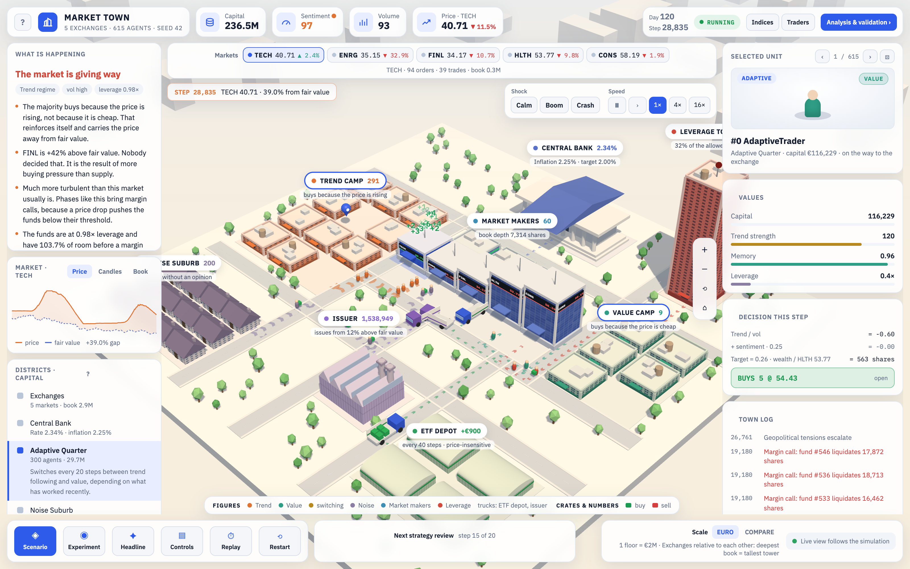
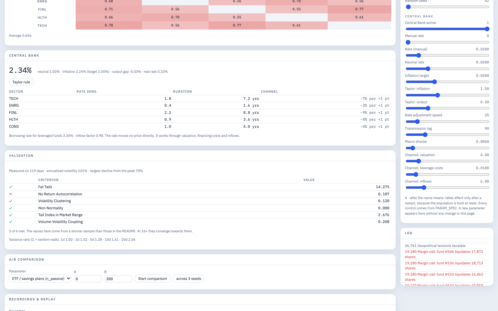
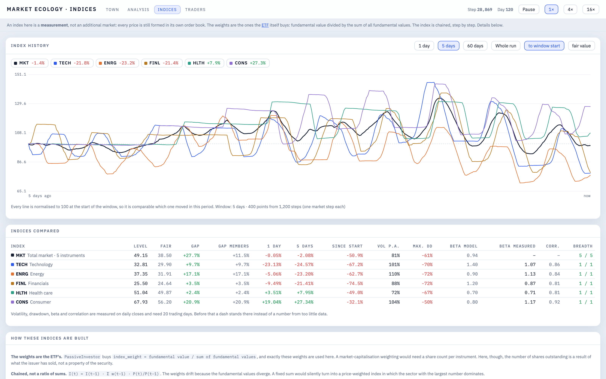
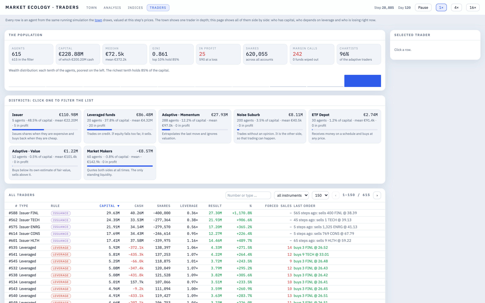

# Market Ecology Simulator

An agent-based model of an equity market. It does not forecast prices — it asks
where market behaviour comes from.

Several hundred agents each follow a simple rule. None can see the true value of
the asset, none knows what the others are about to do, and nowhere in the code is
there an equation for the price. Every trade is one order crossing another in a
continuous double auction. Bubbles, crashes, volatility clusters and forced-selling
cascades are either produced by that interaction or they are not there at all.

The interface is a small town in 3D, drawn like a strategy game: every district is
a group of agents, every building a quantity of capital, every road an order flow,
every walking figure ten agents carrying an order. Nothing in it is decoration.
English is the project's language — interface, API text, documents and code.



```bash
./start.sh          # → http://127.0.0.1:8000           the town
                    # → http://127.0.0.1:8000/sectors   the analysis page
                    # → http://127.0.0.1:8000/indices   every index, live
                    # → http://127.0.0.1:8000/traders   every trader, in one table
```

Python 3.11 or newer, developed and tested on 3.14. `start.sh` builds the virtual
environment and installs `requirements.txt` on first run; there is nothing else to
set up, no database and no build step.

Four views of one running simulation, each answering a different question, all
reachable from each other. The town draws one market as a place; `/sectors`
compares the instruments; `/indices` asks the only question a level answers —
which of these ran, when, and against what; `/traders` shows the population that
produced all of it.

Or double-click **`Market Town.app`** in this folder, which does the same in a visible
Terminal window and opens the browser when the server answers. Drag it to the Dock
once and it stays there — the Dock keeps an alias, so the bundle has to stay in the
project folder next to `mes/` and `start.sh` (`MES_HOME` overrides that, `MES_PORT`
the port). It is generated, not committed as a blob:

```bash
python scripts/build_app.py
```

Two documents live in [`docs/`](docs/), both generated from the running code so
neither can quote stale figures:

```bash
python docs/build_quickstart.py   # Quick Start Guide, 5 pages — what it is, how to work with it
python docs/build_handbook.py     # the Handbook — seven guided experiments, where the model is wrong
```

The short one refuses to write a sixth page rather than growing quietly into the
long one.

First start creates the virtual environment and installs dependencies. The server
answers within a few seconds and then fast-forwards the market to 110 trading days
in the background — the validation panel needs a hundred days of daily bars before
any of its figures mean anything, and the first few dozen days are the run settling
down rather than the model behaving. Watching it catch up is a better answer than a
blank screen; `warming` in `/api/state` says whether it is still doing so.

## The question

Real return series share a handful of statistical properties that hold across
assets, markets and centuries — fat tails, clustered volatility, near-zero
autocorrelation, a tail index between 2 and 6 (Cont 2001). None of them are built
into this model.

**Does a market populated only by simple, heterogeneous rules reproduce them
anyway?**

Defining the criteria *before* running the model is what makes the answer worth
anything. They live in [`mes/metrics.py`](mes/metrics.py) as executable checks, and
`scripts/calibrate.py` reports them across several seeds — a result that holds for
one seed is not a result.

## Result

Five sector instruments trade at once — technology, energy, financials, health
care, consumer — each with its own order book. The criteria are checked **per
instrument**, because they are a claim about each market: a model where two
sectors look right and three do not has not reproduced anything, and an average
would hide it.

Five seeds × five instruments = 25 measurements, 90 000 steps each (≈ 370 trading
days):

| Criterion | Requirement | Measured | Measurements met | |
|---|---|---|---|---|
| Volatility clustering | mean ACF of \|returns\|, lags 1–10 > 0.05 | 0.217 ± 0.109 | 25/25 | ✅ |
| Non-normality | Jarque-Bera p < 0.05 | 0.0002 ± 0.0008 | 25/25 | ✅ |
| Fat tails | excess kurtosis > 1 | 5.39 ± 5.93 | 24/25 | ✅ |
| Tail index | Hill estimator in (2, 6) | 4.38 ± 1.37 | 22/25 | ✅ |
| **No return autocorrelation** | **\|ACF(1)\| < 0.1** | **−0.223 ± 0.156** | **8/25** | ❌ |
| **Volume–volatility coupling** | **corr(volume, \|return\|) > 0.1** | **−0.072 ± 0.129** | **3/25** | ❌ |

Annualised volatility 1.31, maximum drawdown −0.62, **average sector correlation
0.398**, 786 margin calls, trend-follower share varying with a standard deviation of
0.39.

```bash
python scripts/calibrate.py --runs 5 --steps 90000
```

The same six criteria are checked live, on whatever days the running simulation
has, next to the measured correlation matrix and the central bank's three
channels — `/sectors`:



Per instrument:

| | criteria met | volatility | \|price − fair\| | ACF(1) |
|---|---|---|---|---|
| FINL Financials | 4.8 / 6 | 1.31 | 89 % | −0.185 |
| HLTH Health care | 4.4 / 6 | 0.89 | 39 % | −0.170 |
| CONS Consumer | 4.2 / 6 | 1.24 | 33 % | −0.222 |
| ENRG Energy | 4.2 / 6 | 1.40 | 26 % | −0.251 |
| TECH Technology | 3.8 / 6 | 1.74 | 29 % | −0.284 |

### What the last round of fixes changed

Four things that were wrong are no longer wrong, and two got worse. Both directions
came from one root cause, which is the interesting part.

The "after" column is the same measurement as the results table above — five seeds,
90 000 steps, re-run to check that it still is. Four of its rows had drifted out of
step with that table and are corrected here; the figures below are the ones
`scripts/calibrate.py` prints today.

| | before | after |
|---|---|---|
| **sector price correlation** | 0.19 | **0.398** |
| fat tails | 12/15 | **24/25** |
| volatility clustering | 12/15 | **25/25** |
| non-normality | 12/15 | **25/25** |
| tail index | 8/15 | **22/25** |
| **margin calls (default)** | 0 | **786** |
| return autocorrelation | +0.015 (6/15) | −0.223 (8/25) |
| annualised volatility | 0.70 | 1.31 |

**A market's capital has to scale with the number of markets in it.** Agents spread
themselves across the instruments, so with five of them each market saw a fifth of
the capital while its fair value diffused exactly as fast as before. Prices could not
keep up — technology and financials settled 135 % from fair value — and because each
price was then driven by its own order flow rather than by its fundamental, the
correlation the factor model puts into the *fair values* barely reached the prices at
all. Real within-sector price correlations are 0.4–0.6; this model produced 0.07.

Scaling capital and stock by the instrument count fixed the correlation outright, and
with it four of the six criteria became robust across every seed. It also revealed a
second imbalance: market makers are tied to one instrument, so their size did *not*
scale, and the book was thin by exactly the instrument count. Volatility doubled until
their quoting size scaled too.

**Margin calls were dead code at the default.** The funds settle near 1.6× leverage,
because their appetite falls as prices rise above fair value, so equity over exposure
sits near 0.62 — and a maintenance floor of 0.25 is never touched. The cascade only
ever ran in scenarios that raised the floor by hand. At 0.38 calls are occasional; at
0.44 they fire every other step. That is now the default, set against the leverage the
model actually produces rather than the leverage it permits.

The cost of both fixes is visible above: better tracking of fair value means more
mean reversion, and forced selling adds both reversion and volatility. That trade-off
has been the spine of this whole model — the anchor that keeps a price honest is the
same thing that makes its returns predictable.

### Still wrong, and what was tried

**Two criteria fail and I could not fix them.** Four rounds of work moved the other
four from "passing in twelve of fifteen measurements" to "passing in every one", but
these two did not move:

| | best reached | at what cost |
|---|---|---|
| return autocorrelation | −0.03 on a single seed | that configuration had a sector correlation of 0.19 and no margin calls |
| volume–volatility coupling | +0.13 | only alongside a much thinner book |

The reason is one trade-off, and it has been the spine of this model from the start:
**the anchor that keeps a price honest is the same thing that makes its returns
predictable.** Better tracking of fair value means more mean reversion. Forced selling
adds reversion and volatility. Every mechanism that improved the price's grip on its
fundamental made the autocorrelation worse, in the same direction, every time.

One structural attempt is worth recording because it looked right and was not.
**Valuation-driven agents originally saw the fair value instantly**, which is
obviously unrealistic — estimates arrive with reports and get revised — and the lag
seemed like the reason every correction landed inside a single day. It was not. With a
lagged estimate the price *trends* instead of reverting: the autocorrelation flipped
to +0.18, prices drifted further from fair value (45 % against 25 %), the sector
correlation fell from 0.42 to 0.13 and the margin cascade stopped firing. Tested at
half-lives of 0.5, 12 and 30 trading days, worse than no lag on five of six criteria
in all three. `perception_lag_days` is still there, defaulting to zero, so the failed
hypothesis can be re-run rather than taken on trust.

The one attempt that did work: **market makers now quote more size when information
arrives quickly**, rather than only widening their spread. A maker that withdraws when
the market gets busy suppresses trading exactly when a real market trades most, and
since most volume is maker volume that broke the volume relationship at its source.
Worth 5.0 → 5.6 criteria on a single seed, and it also lifted the tail index and
doubled the margin calls.

- **Volatility 1.31 a year** is high for equities.
- **Financials sit 89 % from fair value**; the other four sectors are within 40 %.

**One inconsistency is unresolved, and it is upstream of every figure above.** The
market maker's inventory limit is two different numbers. Its quote skew normalises
against `mm_inventory_limit * scale` ([`mes/agents.py`](mes/agents.py)), where `scale`
is the instrument count, while the hard short floor in `Simulation._submit` is
`-mm_inventory_limit` without it. At the default the maker therefore skews as though
its limit were 30 000 shares and is cut off at 6 000, so its lean never exceeds about
0.2 and the mechanism that is supposed to pull its quotes back towards flat barely
acts. With one instrument `scale` is 1 and the two definitions coincide, which is why
the original single-asset calibration never showed it.

Which definition is right changes the depth of the book, and book depth moves every
number in the validation table. It is named here rather than quietly fixed because
fixing it would invalidate the measurements above and they would all have to be re-run;
[`test_market_makers_respect_their_inventory_limit`](tests/test_simulation.py) asserts
the unscaled form, so the test suite currently states what the code does rather than
what it should do. That is the honest position and not a comfortable one.

**The live panel will show different figures from these tables.** It reports on
whatever days it has, and the tables are 370 days over five seeds. Single runs vary a
lot: the same defaults measured on one seed over 60 000 steps gave 5.0 of 6 with an
autocorrelation of −0.03. That spread is why the criteria are defined over several
seeds and why `scripts/calibrate.py` is the number to quote.

## The participants

Seven kinds of agent. Each exists because the model was visibly wrong without it,
and the notes below are what the calibration actually showed.

| Agent | Rule | Why it is in the model |
|---|---|---|
| **Value investor** | buys below its own estimate of fair value, sells above | the only force pulling the price towards value |
| **Trend follower** | extrapolates the recent move, ignores valuation | the feedback loop that produces bubbles |
| **Noise trader** | trades for reasons the model does not represent | background liquidity |
| **ETF / savings plan** | receives money on a schedule, buys at any price | price-insensitive demand |
| **Leveraged fund** | borrows to amplify a blended view | forced selling; the cascade mechanism |
| **Market maker** | quotes both sides continuously, leans on inventory | without it the book held ~600 shares against orders of several thousand, so every order swept every level and volatility was 129 % a year — an artefact of the matching engine, not of anyone's behaviour |
| **Issuer** | sells new shares when they are expensive, buys back when cheap | without it there is no supply: value investors sell out, market makers hit their inventory limit, and the price then rises to twice fair value and stays there |

Value investors and trend followers are the same class of agent. They switch
between the two rules, and that switching is where the interesting behaviour comes
from. No agent knows the fair value directly and none knows what the others will do.

## How switching works

Each agent periodically reconsiders which rule to run, driven by two forces taken
from the literature:

- **relative success** — switch towards whatever has been paying (Lux & Marchesi 1999)
- **the crowd** — switch towards whatever most others are already doing (Kirman 1993)

The herding term makes the population **bistable**: it locks into a trend-chasing
regime (volatile, bubble-prone) or a value regime (calm, mean-reverting) and stays
there for a while. That persistence is what clusters volatility, and none of it is
written into the price process.

Two details took several attempts, and both look like modelling choices while
actually being bugs:

1. **A strategy is scored on its own merits, not on its members' results.** Score
   by membership and the mechanism collapses the moment a camp empties: with nobody
   running the value rule there is nothing to measure, the population can never be
   drawn back, and herding locks every agent into one strategy permanently. The fix
   is Brock & Hommes (1997) — score the *rule* by what it would have earned,
   whether anyone followed it or not.
2. **Score over the period the rule actually holds a position.** Measured per step,
   the mid barely moves and price changes are smooth, so trend following is
   profitable almost by construction. Momentum then wins every time and there are
   again no regimes.

## How the autocorrelation problem was found

The single-asset version of this model failed the autocorrelation criterion badly —
−0.48 at first, −0.19 after several rounds — and spreading the agents over five
sectors is what finally fixed it. The route there is the most useful thing in this
repository, because almost every plausible explanation was wrong.

### The diagnostic that mattered

The variance ratio — Var(k-period return) / (k · Var(1-period)) — separates
permanent from transient variance. A random walk scores 1 at every horizon.

```
  20 steps   5.79      strong trending
 240 steps   0.72      one day, already reverting
4800 steps   0.066     twenty days
```

0.066 means the variance of 20-day returns was 6.6 % of a random walk's. The price
was pinned to fair value — annualised price volatility 0.79 against fundamental
volatility 0.15 — so about 90 % of all price movement was transient, and transient
movement must by definition be taken back. It is now part of every report
(`variance_ratio` in [`mes/metrics.py`](mes/metrics.py)).

### What was ruled out

| Hypothesis | Test | Outcome |
|---|---|---|
| Market makers skewing prices with inventory | remove them entirely | ACF stays at −0.40 |
| Continuous rebalancing (targets are wealth ÷ price, so a rising price mechanically triggers selling) | no-trade band of 5–30 % | no effect, other criteria worse |
| The issuer over-correcting (bang-bang control) | proportional issuance | no effect |
| Value investors correcting too fast | price pull 0.08 → 0.005, sizing 0.35 → 0.05 | ACF gets *worse* (−0.22) |
| Too short a trading day | 10 → 30 → 120 → 360 steps per day | ACF(1) ≈ −0.4 throughout, ACF(2…5) ≈ 0 |
| Measurement noise in the close | average over the last 5 % of the day | −0.43 → −0.39 |

Two of those conclusions replaced earlier ones drawn from the same experiments run
before the strategy-switching fix. The dynamics had changed underneath them, which
is a good argument for re-running an ablation rather than trusting a note.
`scripts/sweep.py ablate` exists for that.

### What did work

A structural finding first: **volatility clustering and mean reversion were the same
mechanism.** Clustering came from the population switching between trend-following
and value regimes — and the switch back to value *is* the reversion. Every parameter
that reduced the autocorrelation also destroyed the clustering, because they were
two views of one thing. That is why no setting satisfied both, and the fix had to be
a second, independent source of clustering:

1. **Clustered information.** The fair values' volatility is itself persistent (an
   AR(1) in log variance) — quiet weeks follow quiet weeks. Real news arrives in
   bursts, and this puts the clustering into the *permanent* component, where it
   needs no reversion.
2. **Activity follows information.** Trading activity scales with the information
   intensity — Clark's (1973) mixture-of-distributions argument. This is what
   finally produced a positive volume–volatility correlation.
3. **Market makers that do not disappear.** Their spread widened so sharply with
   volatility that a busy market produced *fewer* fills, since most volume is
   theirs.

Those took −0.48 to −0.19. **The five sectors took it the rest of the way**, and in
hindsight the reason is the same as the diagnosis: much of the reversion was one
crowd moving through one book together. Give them five books and the coordination
falls apart.

One caution about single runs: at one point a seed produced −0.002 with all six
criteria met, and it did not replicate — the mean over four seeds was −0.19 with a
spread of 0.11. Reporting that run as success would have been exactly the trap this
project's own method warns about.

## The sectors

Fair values are not drawn independently. Each instrument's follows a common market
factor, a sector shock and its own idiosyncratic noise:

```
d log F_i = drift + beta_i · market_shock + sector_shock_i + idio_vol_i · eps_i
```

Correlation therefore **emerges** from a shared driver rather than being imposed as
a matrix, and it moves over time as the relative size of the three components does.
The sectors are deliberately different characters — technology high-beta and
bubble-prone, energy volatile, financials rate-sensitive, health care and consumer
defensive — so they are not five copies of one series.

Two couplings run between the markets, and neither is configured:

1. **A shared fair-value factor.** Good news for the market is good news for every
   sector, scaled by its beta. A sector-specific headline hits one instrument only.
2. **A shared balance sheet.** Agents hold portfolios, and the margin test is at
   portfolio level. A leveraged fund in trouble because of one sector is liquidated
   across *all* of them, so stress crosses from one market to another through the
   forced seller rather than through any correlation term.
   [`test_forced_selling_spreads_across_sectors`](tests/test_sectors.py) states
   that as a falsifiable claim: every position has to shrink, not only the one that
   caused the problem.

## The indices



Every price in this model comes out of one order book. An index does not — it is a
measurement across several of them, and [`mes/indices.py`](mes/indices.py) is the
only place that measurement is made. It draws no random numbers and changes no
state, so a run with the index book and a run without it are bit-identical.

**The weights are the ETF's.** `PassiveInvestor` buys `index_weight`, which is
`fundamental / Σ fundamentals`, and that is the weighting used. It is the only index
weighting the model already contains: a capitalisation weighting would need a share
count per instrument, and the number of shares in issue here is a consequence of
what the issuer sold rather than a property of the instrument. Using the ETF's own
weights makes the market index the thing a passive investor in this market actually
holds.

**The index is chained**, `I_t = I_{t-1} · Σ w_{i,t-1} · (P_{i,t}/P_{i,t-1})`, for
the reason real indices are: the weights move. A plain `Σ P / Σ P₀` would quietly
become a price-weighted index, and with `stocks_per_sector` above zero the
instrument with the largest number would dominate for no economic reason. The same
construction runs on the fair values, so the gap between the two lines is the
aggregate of a single instrument's `stretch()`.

### Do the configured betas survive the journey into the prices?

The sector betas in `SECTOR_SPEC` act on the **fair values**. Whether they reach the
**prices** is a claim about the model, not a setting — and the answer is more
interesting than "they are damped". Five seeds × 370 trading days:

| Sector | beta given to the fair value | beta measured on the prices | correlation with the market |
|---|---|---|---|
| TECH Technology | 1.40 | 1.38 ± 0.19 | 0.69 |
| ENRG Energy | 0.90 | **1.19 ± 0.17** | 0.68 |
| FINL Financials | 1.20 | **0.92 ± 0.41** | 0.64 |
| HLTH Health care | 0.70 | 0.66 ± 0.15 | 0.69 |
| CONS Consumer | 0.80 | 0.87 ± 0.10 | 0.75 |

**The spread survives almost intact** — 0.70 configured against 0.72 measured —
which is not what the correlations do. **The ordering does not:** energy and
financials swap places, and financials scatter by ±0.41, so any statement about its
beta from a single run would have been a guess. That is why the table reports the
spread, and it is the same lesson as everywhere else in this project: one seed is
not a result.

### Two deviation columns, and why

A chained index compounds a weighted *arithmetic* mean of returns. The price series
are far noisier than the fair values, so the price index accumulates the larger
rebalancing premium, and after a year the market index sits a double-digit
percentage above its fair-value index while no single member is that far from fair
value. Both numbers are therefore reported: `gap` is index against fair-value index,
`gapMembers` is the weighted mean of price ÷ fair value measured today. For an index
with one member they are identical, which
[`tests/test_indices.py`](tests/test_indices.py) asserts — that identity is what
proves the chaining telescopes correctly, and it is the only independent reference
the multi-member case has.

## Every trader in one table



The town shows one agent at a time and steps through them with two arrows. That is
the right way to read *a* trader and a hopeless way to read six hundred: there was
no way to ask which fund is closest to a margin call, whether the value camp is
actually poorer than the momentum camp, or who is carrying the losses — questions
the model answers on every step and nothing displayed.

[`mes/traders.py`](mes/traders.py) is to the roster what
[`mes/city.py`](mes/city.py) is to the town: the only place simulation state becomes
the numbers the table shows. Sorting, filtering and paging happen there rather than
in the browser, because six hundred rows with a position per instrument is not a
payload to send in full so that a click can reorder it.

`/traders` carries a rollup per district — count, capital, share, mean, how many are
in profit — computed over the whole population and never over the filtered page,
because a rollup that shrinks when a search box is typed into is answering a
different question from the one its label promises. Clicking a row shows that
trader's portfolio marked to the current prices; a link hands it to the town, which
reads `?agent=` and selects it.

Two things it says that nothing else did. **Profit is measured against the start of
the run**, not against the last strategy review — `Agent.last_wealth` is the
review's baseline and moves, so it could not answer "how has this trader done".
And **an order is shown as open only while it is this step's**: `last_orders` keeps
the last one for ever, and a row reading "buys 300" for an agent that has not traded
in twenty thousand steps is a lie with a timestamp beside it.

## Individual stocks inside sectors

`stocks_per_sector` switches between two worlds. At 0 — the calibrated default — the
five sectors are the instruments. Above 0 each sector is represented by that many
stocks (`TECH-1`, `TECH-2`, …) and the sector stops being tradable: it becomes a
shared shock with an index but no price of its own.

A stock is only something other than a sixth sector if it **shares** its sector's
shock, and that took a correction. The factor model originally drew a separate
"sector" shock for every instrument, which works when each instrument *is* a sector
and is meaningless once several share one — the label would have been decoration.
Now one shock is drawn per sector and every member is hit by that same number.

That gives a falsifiable claim: two stocks in the same sector should move together
more than two stocks in different sectors, with no pairwise correlation written
anywhere. Measured over three stocks a sector and 40 000 steps:

| measured on | within a sector | across sectors | gap |
|---|---|---|---|
| **fair values** | 0.322 | 0.187 | **0.135** |
| prices | 0.069 | 0.027 | 0.042 |

The hierarchy is clearly there in the fundamentals and reaches prices at about a
third of its size. Removing the shared shock (`sector_vol = 0`) shrinks the gap
threefold, which is the control that attributes it to the mechanism rather than to
something else. It does not vanish, and the reason is worth knowing: stocks in a
sector also carry similar betas, so they load on the common market factor alike.

**The attenuation is a limitation, not a detail.** Real within-sector price
correlations sit around 0.4–0.6; this model produces 0.07. Each market's price is
dominated by its own order flow, which is the same finding the variance ratio gave
earlier — most price variance here is transient. Individual names are worse than
sector indices in this respect, because a single stock is noisier by construction and
its price has even more trouble tracking a fair value that moves.

[`tests/test_stocks.py`](tests/test_stocks.py) asserts the fair-value ordering and
the attenuation, and deliberately does *not* assert the price-level ordering: with
five within-sector pairs over sixty days the sign flips between runs, and a test for
it would be a coin toss dressed as a check.

Cost: order flow is scaled per instrument, so ten instruments run at roughly 225
steps a second against 440 for five. The default stays at sector instruments because
that is the configuration the validation figures above were measured on.

## The central bank

It does not trade. It sets one number and that number reaches the market through
three channels — which is the whole reason to model it, because the same decision
arrives differently depending on which channel dominates.

| Channel | Mechanism |
|---|---|
| **Valuation** | a rate move repricies fair values by the sector's duration: 8.8 years for financials, 1.6 for energy. Driven by the *change* in the rate, so a cut gives back what a hike took |
| **Funding** | leveraged funds pay `rate + spread` on borrowed money, so equity erodes while they wait and margin calls come sooner |
| **Flows** | savings plans put less into equities when cash pays; at 10 % roughly half as much arrives |

The rate itself comes from a Taylor rule reacting to inflation and an output gap,
and the macro block reacts back with a lag. That loop is the point: a bank facing an
economy that does not respond is just a scripted rate path, and then the interesting
question cannot be asked. Load **Rate turn 2022**, where only an inflation shock is
scripted, and the rest follows:

```
 Day   Rate  Inflation  Output gap
   6   2.00%     7.50%       +0.00     the shock
  50   8.58%     6.58%       -0.16     peak — inflation already falling
 200   1.86%     1.87%       -1.71     recession
 300   0.34%    -0.33%       -1.69     undershoot, zero bound
```

The bank keeps tightening while inflation is already falling, because what the
economy feels is a lagged version of the stance — and then it overshoots the other
way. Nobody wrote that; it is a property of the delay. That run also produced 2 521
margin calls, the first time the leverage cascade fired without the scenario being
rigged for it.

Two things about this module were mistakes worth recording. It draws from **its own**
random stream (`seed + 7919`), because an optional module drawing from the shared one
changes every later number — switching it off then does not give the same world
without a bank, it gives a different world, and that confound produced two wrong
conclusions here before it was fixed. And `macro_shock` is far more powerful than it
looks: at 0.02 the rate wandered enough that repricing by duration dominated
everything else and the validation fell from five criteria to three.

## Reading the town

Nothing in it is decoration, and every number on it comes from
[`mes/city.py`](mes/city.py) — the one place simulation state is turned into the
quantities the drawing code uses, so that code never has to interpret anything.
`cityModel()` in [`web/index.html`](web/index.html) turns those quantities into
blocks, roads and figures on an 800 × 800 plate; [`web/town3d.js`](web/town3d.js)
draws that model with three.js and reads nothing else. A test holds it to that.

| On screen | What it is |
|---|---|
| block height | capital standing in that district; the footer states the scale, which steps down as the market compounds |
| coloured lane on the streets | one group's route from its district to the exchange square, along the street grid with its corners; the lane's width is that group's order flow this step, its chevrons run towards the exchanges |
| one figure | ten agents carrying an order to the exchange |
| the crate it carries | the side of that group's orders this step: green buy, red sell, in the measured proportion (`buyShare`) |
| golden figures between the camps | adaptive agents switching strategy |
| trucks | the ETF depot's scheduled purchases (green cargo) and the issuer's new shares (red cargo) — two groups that trade in lumps; a truck leaves when its group traded this step and parks again after the trip |
| smoke over the issuer | it sold stock this step |
| the five blue towers | the five exchanges, one per sector, scaled against each other by book depth; the band shows symbol and price, the selected one is brighter |
| numbers above a tower | the fills that actually happened, in the selected market |
| hatched floors on the red tower | borrowed capital: exposure above equity |
| red beacon and ring | a margin call — a fund is selling because it must, not because it decided to |
| light and rain | sentiment: warm sun when greedy, overcast when fearful, rain in panic |
| blue pin | the selected district |

Trees and the faint town on the horizon claim nothing. Drag to turn the camera,
scroll to zoom, right-drag to pan; clicking a building selects its district, clicking
a tower selects its market. Without WebGL the page says so and the panels still work.

The **Market** panel on the left shows the selected instrument three ways: the price
against its fair value, the daily candles, and the order book. The last one is where
a price in this model comes from — every trade is one order crossing another — and it
is worth looking at at least once: nearly all the resting size sits at the touch,
where the market makers put it, and everything behind it is a handful of shares. That
is not a drawing decision, it is what `n_makers` market makers quoting `mm_quote_size`
per side produces.

The districts are the participants. Clicking one explains what it is for on the left
and loads a real member of it on the right, with the arithmetic behind its last
decision and the market that arithmetic divided by.

Two scales are deliberately separate. A district's height is capital; an exchange's is
book depth. They are different quantities, and with five exchanges each carrying a
fifth of the order flow, putting them on the district ladder pushed every one onto the
minimum height — five buildings meant to be compared, all identical. The issuer is a
fixed landmark for the same reason: it holds the proceeds of every share it ever sold,
several times the rest of the town put together, and on the euro ladder it would be
the only building you could see.

Two scales, switchable in the footer, because one linear ladder cannot serve both
ends once the market has run for a while. After a hundred trading days the trend
followers hold most of the capital and the spread between the largest and the
smallest block reaches 135× — the ladder then has to serve the giant, and 21 of 35
blocks sit on the minimum height, indistinguishable. **EURO** is the default and the
honest one: a single flat district beside one tower *is* the concentration, drawn
correctly. **COMPARE** is logarithmic, 14.4 floors per tenfold, and says so in the same
line — it exists so the small districts can be compared with each other. Exactly the
argument the exchanges already won.

The footer reaches the five things the model can be asked to do — load a **scenario**,
run a guided **experiment**, inject a **headline**, move a **control**, open a
**recording** — plus a restart. Shock and speed sit on the map, in the command bar. The `?` in the corner states what the town is and what
to try first.

A recording opens *in the town*: the scrubber moves the whole map, book and districts
and agents included, because a replay is recomputed from its seed rather than read
back from a series, so every position holds the whole state. Forwards it steps on
from where it stands, backwards it recomputes from step 0 — both land on bit-identical
state, and the bar says which it is doing and how many steps that costs.

Keyboard: space pauses, `]` steps once, `1`/`2`/`3` set the speed, `R`/`B`/`C` inject
a calm, boom or crash shock, `+`/`−`/`0` move the camera, `?` opens the explanation.

## Scenarios

Presets in [`mes/scenarios.py`](mes/scenarios.py), each carrying the question it is
meant to answer. A scenario sets conditions and supplies headlines; it never
scripts a price path.

Basic: calm market, bubble formation, leverage crash, ETF dominance, news shock.

Historical: dotcom 1998–2000, financial crisis 2008, COVID crash 2020, meme stock
2021, rate turn 2022. These reproduce **mechanisms, not price paths**. Fitting
parameters until a chart matched history would prove nothing; the question asked is
narrower — does the mechanism thought to drive that episode produce that kind of
behaviour in a model that was not built for it?

## API

| Route | Purpose |
|---|---|
| `GET /api/state` | town snapshot (see `mes/city.py`); `failure` is non-null if the clock has stopped |
| `GET /api/series?n=&symbol=` | price, fair value, volume, trend-follower share, for one instrument |
| `GET /api/bars?n=&symbol=` | daily OHLC candles, for one instrument |
| `GET /api/sectors` | instruments grouped by sector, correlation matrix, within-vs-across |
| `GET /api/sectors/{symbol}` | one instrument: history, book, tape, own validation |
| `GET /api/indices?n=&points=&scale=` | every index: level, fair-value index, curve, volatility, drawdown, measured beta. `n` is how far back, `points` how many samples — two numbers, deliberately |
| `GET /api/traders?sort=&order=&kind=&strategy=&symbol=&q=&limit=&offset=` | the whole population, sorted and filtered on the server, with a rollup per district |
| `GET /api/traders/{aid}` | one trader in full. Read-only, unlike `/api/agents/{aid}`, which selects one in the town as a side effect of being read |
| `GET /api/centralbank` | policy rate, macro state, the three channels |
| `GET /api/explain` | what is happening, why, and what to watch |
| `GET /api/lessons` · `POST /api/lessons/{key}` | the guided experiments, with what each costs in wall clock |
| `GET /api/lessons/{key}/check` | has the experiment shown what it set out to show, and how much longer |
| `POST /api/centralbank` | set the rate by hand, or hand it back to the rule |
| `POST /api/compare` | two configurations from one seed, with a difference table |
| `POST /api/compare/sweep` | the same pair over several seeds, with signal/noise |
| `GET /api/runs` | recorded runs on disk |
| `POST /api/replay` · `/seek` | open a recording and scrub it, recomputed from its seed; every position comes back shaped like `/api/state`, so the town draws it |
| `GET /api/metrics` | validation report, wealth distribution, strategy performance |
| `GET /api/params` | every parameter with its spec from `PARAM_SPEC`, plus the calibrated defaults |
| `POST /api/params` | change live parameters, or restart onto new ones; a configuration the model cannot build is a 400 and the running market survives it |
| `POST /api/control` | `play`, `pause`, `step`, `reset`, `speed`, `select`, `market` |
| `DELETE /api/compare` · `/api/replay` | discard a comparison or close a recording |
| `POST /api/scenario/{crash,calm,boom}` | inject a quick shock |
| `GET /api/scenarios` | preset catalogue, grouped |
| `POST /api/scenarios/{key}` | restart under a preset and queue its events |
| `POST /api/news` | announce a headline by hand |

The crash scenario does not script a crash. It lowers fair value, turns trend
following up and lets the leverage work. Whether the price falls 5 % or 40 % is the
simulation's answer.

## Design notes

**The order book is real.** Continuous double auction with price-time priority,
partial fills, cancellation and expiry ([`mes/orderbook.py`](mes/orderbook.py), 13
tests). A `price *= (1 + k * net_demand)` model cannot explain a liquidity hole,
because it has no liquidity to run out of.

**One step is not one day.** A step is a market period; `steps_per_day` (240) of
them make a trading day with an OHLC bar. The stylized facts are properties of
*daily* returns — measured per step, the same code reports an excess kurtosis of 86
and a tail index of 0.85. The API therefore refuses to report the criteria at all
until a hundred days exist, rather than showing step-level numbers with green ticks
beside them.

**News never touches the price.** `World.apply_news` moves fair value and mood.
Whether the price moves depends on the agents: a value investor sees a cheaper
asset, a trend follower sees others selling, the ETF does not read the news at all.
That asymmetry is the point.

**Tests check invariants, not numbers.** Shares are conserved, only market makers
and the issuer may go short, only leveraged funds may borrow, the same seed gives
the same run. Whether a scenario called "bubble" produces a bubble is a result and
is deliberately not asserted. [`tests/test_metrics.py`](tests/test_metrics.py)
checks the checker: Gaussian noise must *fail* the fat-tail test and a GARCH-shaped
series must pass the clustering test, because a checklist that passes everything
measures nothing.

## Commands

```bash
./start.sh                                              # interface
python scripts/run.py --steps 120000 --name baseline    # headless + Parquet export
python scripts/calibrate.py --runs 3 --steps 90000      # validation, per instrument
python scripts/sweep.py ablate --steps 80000            # switch each mechanism off in turn
python scripts/sweep.py param --name n_passive --values 0,50,100,200
python scripts/demo_state.py --write                    # regenerate the offline snapshot
python scripts/build_app.py                             # rebuild Market Town.app and its icon
python scripts/screenshots.py                           # rebuild the images in this README
pytest                                                  # 324 tests
```

`web/index.html` also works without the backend: it falls back to one snapshot and
says so in the footer. That snapshot is **generated** from a real run by
`scripts/demo_state.py` rather than written by hand — the two hand-written ones that
used to live there had drifted to 550 agents and a single exchange, and the page
showed those figures for the first second of every real session.
`tests/test_frontend.py` compares its key set against a live snapshot, so it cannot
drift again silently.

## Comparing and replaying

Two things a research tool needs that a live view cannot give.

**A/B.** Two configurations from the same seed, stepped together, with a table of
differences. `/api/compare` for one pair, `/api/compare/sweep` for several — and the
sweep is the one to believe. Asking what 200 savings-plan investors do against none:

| | 0 ETF | 200 ETF | Δ |
|---|---|---|---|
| criteria met | 3.4 | 2.4 | −1.0 |
| volatility clustering | 0.052 | 0.002 | −0.050 |
| \|price − fair\| | 6.8 % | 12.5 % | +5.7 % |
| annualised volatility | 0.511 | 0.352 | −0.159 |

**The comparison is now trustworthy, and it was not before.** Every agent draws from
its own random stream, seeded from the run's seed and the agent's id. With one stream
shared across the market, how many numbers an agent consumed depended on what it
decided — so the first behavioural difference desynchronised everybody and the two arms
became different worlds rather than the same world under two policies. A channel worth
0.4 % in fair value produced a 39 % difference after 20 000 steps, nearly all of it
path divergence.

With per-agent streams the difference scales with its cause, measured over 20 000 steps:

| change | arms end up apart by | diverge from step |
|---|---|---|
| borrow spread 1.00 % → 1.05 % | 0.4 % | 732 |
| savings-plan inflow 30 → 33 | 0.0 % | 763 |
| trend following 55 → 140 | 3.5 % | 2 |

And a parameter that cannot act does nothing: `max_leverage` changed with no leveraged
funds in the population gives bit-identical runs. That control is in the test suite,
and it is the one assertion that would have failed under the old design.

What a single seed pair still cannot tell you is whether a difference is bigger than
the variation *between* seeds. `sweep_pair` answers that with a `signal_to_noise`
figure per statistic — above one the gap stands out, below one it does not, whatever
one pair of charts looks like. A null test of two identical arms is in the suite and
must come back with a difference of exactly zero.

**Replay.** A recording stores the config, and the simulation is deterministic in its
seed, so a replay is *recomputed* rather than read back. Seeking forward continues;
seeking backward restarts and re-runs. Both land on the recorded price bit for bit,
which the tests assert as identity rather than similarity.

The point of doing it that way is what a series export cannot offer: at every
position the whole state exists — the order book, the districts, the agents — not
only the curves that happened to be written out. The cost is time on a backward
seek instead of disk.

```bash
python scripts/run.py --steps 60000 --name baseline   # record
./start.sh                                             # then open /sectors
```

## Not built

Named so the scope is not mistaken for the plan:

- **The two views stay separate.** `/` is the town, `/sectors` the analysis page.
  Merging them was not attempted — the town reads well because it draws one market at
  a time.
- **No dividends, no earnings.** Fair value is an exogenous process rather than
  something a company produces, so buybacks are financed from a cash pile that never
  refills from operations.
- **No lagged valuation.** The mechanism exists (`perception_lag_days`) and is off,
  because it made the model worse — see above.

## References

- Taylor (1993), *Discretion versus policy rules in practice*
- Clark (1973), *A subordinated stochastic process model with finite variance for speculative prices*
- Lo & MacKinlay (1988), *Stock market prices do not follow random walks*
- Cont (2001), *Empirical properties of asset returns: stylized facts and statistical issues*
- Lux & Marchesi (1999), *Scaling and criticality in a stochastic multi-agent model*
- Kirman (1993), *Ants, rationality, and recruitment*
- Brock & Hommes (1997), *A rational route to randomness*
- Chiarella & Iori (2002), *A simulation analysis of the microstructure of double auction markets*
- LeBaron (2006), *Agent-based computational finance*

## Layout

```
mes/
├── orderbook.py    matching engine, price-time priority — the foundation
├── market.py       one instrument: its book, its history, its candles
├── centralbank.py  Taylor rule, the macro loop, the three policy channels
├── compare.py      two configurations side by side, with the honesty caveat
├── narrator.py     state → an explanation: what, why, what to watch
├── lessons.py      seven guided experiments, each with a measured check
├── agents.py       the seven decision rules
├── simulation.py   the loop: one step() is one market period
├── world.py        fair value, sentiment, news
├── metrics.py      the stylized-fact checks
├── scenarios.py    presets and historical episodes
├── recorder.py     Parquet recording and reproduction
├── instruments.py  the five sectors and the factor model behind their fair values
├── indices.py      the aggregate: chained, ETF-weighted, reading only
├── config.py       every parameter, declared once
├── city.py         simulation state → town view (the only translation point)
├── traders.py      simulation state → roster (the other translation point)
└── api.py          FastAPI: read state, turn parameters, load scenarios
web/index.html      the town: panels, and the model the 3D view draws (no build step)
web/town3d.js       the 3D view: draws cityModel(), reads nothing else
web/vendor/         three.js r159, vendored so the town works offline and from disk
web/sectors.html    the sector view: tiles, heatmap, bank, validation, A/B, replay
web/indices.html    the index board: every index on one rebased axis, live
web/traders.html    the roster: every agent, sortable, filterable, with a detail panel
scripts/            run.py, calibrate.py, sweep.py, demo_state.py, build_app.py, screenshots.py
Market Town.app     Dock launcher: starts the server, opens the town (generated)
docs/               Quick Start Guide and Handbook (PDF, generated by build_*.py)
tests/              324 tests
```
